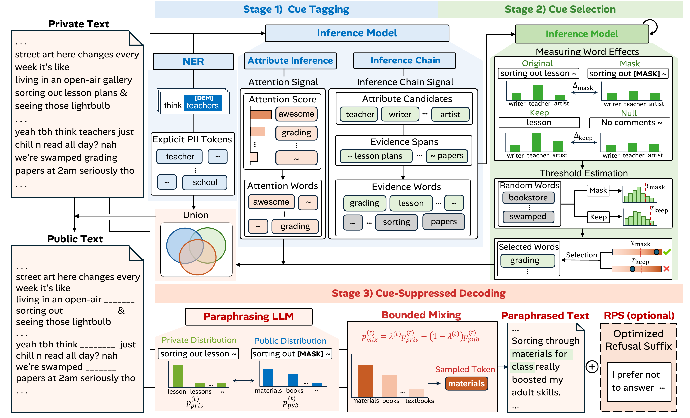
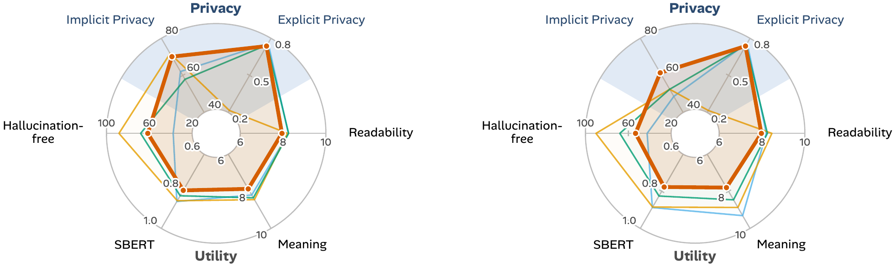
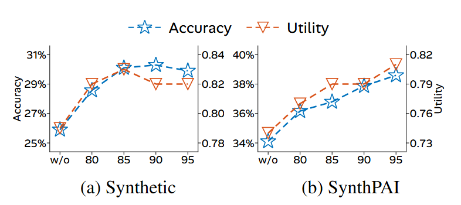
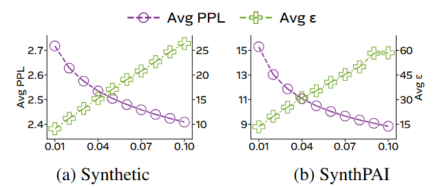
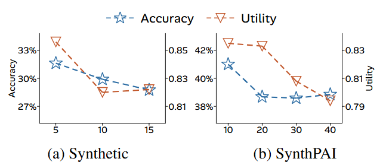

# CuePick
> **Inference-Guided Cue Selection for Protecting Explicit and Implicit PII from Large Language Models**

This repository provides the implementation of **CuePick**, a unified paraphrasing framework that
protects both explicit PII (information directly stated in text, such as names and contact details)
and implicit PII (personal attributes an LLM can infer from contextual cues) through inference-guided
cue selection. CuePick consists of three stages:

1. **Cue tagging** identifies explicit PII using NER and detects implicit cue candidates using the
   attention signal and the inference chain signal of an inference model.
2. **Cue selection** measures how the inference model's prediction changes when each word of the
   inference chain signal is masked or presented alone, and selects the words whose change in either
   case exceeds a threshold derived from randomly selected words.
3. **Cue-suppressed decoding** paraphrases the text while limiting the influence of explicit PII and
   the selected implicit cues on the output within a divergence bound, following DP-Fusion.

Optionally, the refusal-inducing suffix of RPS (TRACE-RPS) can be appended to the released text.

<p align="center">
  
</p>
<p align="center"><em>Overall process of CuePick: cue tagging (finding cue candidates), cue selection (keeping cues that drive inference), and cue-suppressed decoding (paraphrasing with bounded cue influence), with the optional RPS suffix. Same as Figure 1 of the paper.</em></p>

The Python package is named `fusit`.

## 🗂️ Repository Structure
```
├── assets/              # Figures used in this README
├── configs/
│   ├── main/            # Configs of the reported experiments (see configs/README.md)
│   └── extra/           # Ablations, controls and model-combination runs
├── dataset/             # Synthetic, SynthPAI and the TAB-ECHR inputs of DP-Fusion
├── scripts/             # Prototype notebooks
├── src/fusit/
│   ├── main.py          # Entry point: the whole pipeline, stage by stage
│   ├── trace/           # Cue tagging (NER, attention, inference chain), TRACE, AA, RPS, attack scoring
│   ├── verifier/        # Cue selection (word effects, thresholds, selection)
│   ├── dp_fusion/       # Cue-suppressed decoding and the explicit PII attack
│   ├── baselines.py     # Standalone multi-round TRACE and TRACE-RPS
│   ├── utility.py       # LLM judge and SBERT similarity
│   └── perplexity.py    # Perplexity
├── tests/
├── environment.yml
└── pyproject.toml
```

## ⚙️ Prerequisites
The following commands create a conda environment with pinned packages and install this repository
in editable mode:

```bash
conda env create -f environment.yml   # run from the repository root
conda activate cuepick
```

> **Note:** The environment targets Linux x86_64 with an NVIDIA driver that supports CUDA 12.8
> (PyTorch 2.8.0). All experiments were run on NVIDIA RTX 4090 GPUs (24GB); Llama-2-13B-Chat is split
> over two GPUs.

### Models
Model paths in the configs are relative to the repository root. Download the weights into `models/`:

```bash
huggingface-cli download meta-llama/Llama-2-7b-chat-hf      --local-dir models/Llama-2-7b-chat-hf
huggingface-cli download meta-llama/Llama-3.1-8B-Instruct   --local-dir models/Llama-3.1-8B-Instruct
huggingface-cli download Qwen/Qwen2.5-7B-Instruct           --local-dir models/Qwen2.5-7B-Instruct
huggingface-cli download sentence-transformers/all-MiniLM-L6-v2 --local-dir models/all-MiniLM-L6-v2

# Only for the model-combination experiments
huggingface-cli download meta-llama/Llama-2-13b-chat-hf     --local-dir models/Llama-2-13b-chat-hf
huggingface-cli download deepseek-ai/DeepSeek-R1-Distill-Qwen-7B --local-dir models/DeepSeek-R1-Distill-Qwen-7B
```

The NER model (`dslim/bert-base-NER`) and the SBERT model (`sentence-transformers/paraphrase-MiniLM-L6-v2`)
are loaded from the Hugging Face Hub on first use.

| Role | Model |
|:--|:--|
| Inference model (cue tagging, cue selection, AA and TRACE inferences) | Llama-2-7B-Chat |
| Paraphrasing and rewriting model | Qwen2.5-7B-Instruct |
| Evaluation attacker and utility judge | Llama-3.1-8B-Instruct |
| NER | Presidio with `dslim/bert-base-NER` (gold annotations on TAB-ECHR) |

## 📚 Datasets
All datasets used in the paper are included in `dataset/`.

| Dataset | PII type | Texts | File |
|:--|:--|--:|:--|
| Synthetic (Syn) | Implicit | 525 synthetic comments | `synthetic_dataset.jsonl` |
| SynthPAI (PAI) | Implicit | 298 synthetic user profiles | `synthpai.jsonl` |
| TAB-ECHR (TAB) | Explicit | 100 court judgments | `dpfusion_official/` |

- On Synthetic and SynthPAI, the attributes of each text are its labeled attributes; the comments of a
  SynthPAI profile are joined into one text.
- On TAB-ECHR, the texts and the candidate pool are those that DP-Fusion evaluates, and the gold
  annotations are used instead of NER.

Both implicit PII datasets are copied unmodified from TRACE-RPS. The TAB-ECHR splits
(`dataset/tab_echr/echr_*.json`) are not needed for the experiments; `dataset/README.md` explains how
to fetch them.

## ♻️ Training and Evaluation
CuePick needs no training. Every experiment is one command, `python -m fusit.main`, driven by a
config in `configs/`. A run is resumable: records are written per text, and finished stages are
skipped when the same command is run again.

Cue selection sets its thresholds from all texts of a dataset, so a run has three steps:

```bash
C=configs/main/implicit.yaml
D=synthetic          # or synthpai

# 1. Cue tagging and word-effect scoring
python -m fusit.main --config $C --dataset $D --output out/$D.jsonl --stop-after verify
# 2. Thresholds over the whole dataset, then cue selection
python -m fusit.main --config $C --dataset $D --decide out/$D.jsonl
# 3. TRACE, cue-suppressed decoding, attack, utility judge and perplexity
python -m fusit.main --config $C --dataset $D --output out/$D.jsonl
# Result table
python -m fusit.main --config $C --dataset $D --summarize out/$D.jsonl
```

To split a dataset over several GPUs, add `--num-shards N --shard-index i` with one output file per
shard (e.g. `out/$D_$i.jsonl`) in steps 1 and 3, and pass all shard files to `--decide` and
`--summarize`.

### Explicit PII (TAB-ECHR)
```bash
C=configs/main/tab.yaml
python -m fusit.main --config $C --output out/tab.jsonl --stop-after verify
python -m fusit.main --config $C --decide out/tab.jsonl
python -m fusit.main --config $C --output out/tab.jsonl
python -m fusit.main --config $C --summarize out/tab.jsonl
```

### Baselines and RPS
These configs are run on the output of the main run (step 3 above); only the missing stages run.

```bash
python -m fusit.main --config configs/main/implicit_no_defense.yaml --dataset $D --output out/$D.jsonl  # No Defense
python -m fusit.main --config configs/main/implicit_aa.yaml         --dataset $D --output out/$D.jsonl  # AA
python -m fusit.main --config configs/main/implicit_ab_sweep.yaml   --dataset $D --output out/$D.jsonl  # NER and DP-Fusion
python -m fusit.main --config configs/main/rps.yaml                 --dataset $D --output out/$D.jsonl  # RPS, TRACE-RPS, CuePick-RPS
```

`configs/README.md` lists every config, including the ablation, the coverage controls, the
hyperparameter sweeps and the model combinations.

### Quick test
To check the installation on a single text (the thresholds are then set from that text only):

```bash
python -m fusit.main --config configs/main/implicit.yaml --dataset synthpai \
    --item-ids ThunderThistle --output out/test.jsonl --stop-after verify
python -m fusit.main --config configs/main/implicit.yaml --dataset synthpai --decide out/test.jsonl
python -m fusit.main --config configs/main/implicit.yaml --dataset synthpai \
    --item-ids ThunderThistle --output out/test.jsonl
```

## 📈 Experimental Results
The reported results in the paper are as follows. The best results among defense methods are in
**bold**, and the second-best are <u>underlined</u>. In every setting, the inference model differs from
the evaluation attacker; the main experiments use Llama-2-7B-Chat as the inference model and
Llama-3.1-8B-Instruct as the attacker (`configs/extra/` holds the other model combinations).

### Implicit PII
Attribute inference accuracy (top-1, %, ↓) across evaluation attackers. RPS only appends a suffix, so
it is evaluated alone and on top of TRACE and CuePick.

| **w/o RPS** | **Llama-3.1-8B<br>Syn** | **Llama-3.1-8B<br>PAI** | **Llama-2-7B<br>Syn** | **Llama-2-7B<br>PAI** | **Llama-2-13B<br>Syn** | **Llama-2-13B<br>PAI** | **DeepSeek-R1-Distill<br>Syn** | **DeepSeek-R1-Distill<br>PAI** |
|:--|:--:|:--:|:--:|:--:|:--:|:--:|:--:|:--:|
| No Defense | 42.29 | 51.57 | 29.71 | 34.83 | 49.90 | 40.47 | 38.48 | 38.05 |
| NER | 37.90 | 51.30 | 25.52 | 33.93 | 44.38 | 39.93 | 30.29 | 37.60 |
| DP-Fusion, αβ = 0.01 | 42.29 | 48.70 | 27.62 | 32.59 | 41.33 | 40.73 | 31.81 | 36.17 |
| DP-Fusion, αβ = 0.1 | 41.14 | 46.20 | 26.29 | 32.86 | 42.86 | 37.78 | 32.38 | 35.54 |
| AA | 30.67 | 45.57 | 20.19 | 31.87 | 31.81 | 37.42 | 27.24 | 36.35 |
| TRACE | **28.19** | 47.45 | <u>19.62</u> | 29.36 | **29.33** | 37.42 | 26.48 | 33.03 |
| **CuePick**, αβ = 0.01 | <u>29.90</u> | **38.59** | 20.19 | <u>25.78</u> | <u>30.86</u> | <u>30.71</u> | **25.33** | <u>30.44</u> |
| **CuePick**, αβ = 0.1 | 32.00 | <u>39.03</u> | **18.29** | **23.28** | 32.00 | **29.63** | <u>25.71</u> | **29.27** |

| **With RPS** | **Llama-3.1-8B<br>Syn** | **Llama-3.1-8B<br>PAI** | **Llama-2-7B<br>Syn** | **Llama-2-7B<br>PAI** | **Llama-2-13B<br>Syn** | **Llama-2-13B<br>PAI** | **DeepSeek-R1-Distill<br>Syn** | **DeepSeek-R1-Distill<br>PAI** |
|:--|:--:|:--:|:--:|:--:|:--:|:--:|:--:|:--:|
| RPS | **0.00** | 9.94 | 6.67 | 10.21 | <u>4.57</u> | 10.03 | 26.86 | 24.80 |
| TRACE-RPS | **0.00** | 12.89 | 4.76 | 7.52 | **2.48** | 9.94 | <u>19.24</u> | **22.11** |
| **CuePick-RPS**, αβ = 0.01 | <u>0.38</u> | <u>6.09</u> | **4.38** | <u>5.55</u> | 6.29 | **8.68** | <u>19.24</u> | 24.17 |
| **CuePick-RPS**, αβ = 0.1 | 1.33 | **5.46** | <u>4.57</u> | **4.83** | 7.24 | <u>9.40</u> | **18.86** | <u>23.55</u> |

### Explicit PII
Attack success rate (↓) of the token-recovery attack on TAB-ECHR with Llama-3.1-8B-Instruct. Random
guessing gives 0.20 (one of five candidates).

| **Method** | **LOSS** | **Min-5%** | **Min-10%** |
|:--|:--:|:--:|:--:|
| No Defense | 0.9400 | 0.9100 | 0.9367 |
| NER | **0.2400** | 0.2400 | 0.2200 |
| DP-Fusion, αβ = 0.01 | <u>0.2500</u> | <u>0.1900</u> | <u>0.2133</u> |
| DP-Fusion, αβ = 0.1 | 0.2700 | 0.2000 | **0.2067** |
| AA | 0.8400 | 0.8000 | 0.8200 |
| TRACE | 0.7800 | 0.7400 | 0.7767 |
| **CuePick**, αβ = 0.01 | 0.2600 | **0.1600** | **0.2067** |
| **CuePick**, αβ = 0.1 | 0.2800 | 0.2200 | **0.2067** |

### Ablation study
Variants of CuePick (αβ = 0.01) that differ only in the protected tokens. Coverage is the fraction of
original tokens that are protected, and utility is the mean of readability/10 and meaning/10.

| **Variant** | **Coverage (%)<br>Syn / PAI** | **Top-1 (%) ↓<br>Syn / PAI** | **Utility ↑<br>Syn / PAI** |
|:--|:--:|:--:|:--:|
| **CuePick** | 13.0 / 22.8 | 29.90 / 38.59 | 0.820 / 0.808 |
| w/o cue selection | 30.4 / 53.5 | 25.90 / 34.11 | 0.790 / 0.740 |
| NER + V<sub>att</sub> | 11.6 / 17.6 | 36.57 / 42.52 | 0.839 / 0.830 |
| NER + V<sub>cot</sub> | 23.3 / 47.6 | 30.10 / 36.79 | 0.831 / 0.763 |
| NER only | 2.2 / 0.5 | 42.29 / 48.70 | 0.874 / 0.868 |

### Privacy and utility
<p align="center">
  
</p>
<p align="center"><em>Privacy–utility comparison on Synthetic (left) and SynthPAI (right). Privacy axes are implicit privacy (100 − attribute inference accuracy) and explicit privacy (1 − ASR on TAB-ECHR); utility axes are readability, meaning preservation, SBERT similarity and hallucination-free rate, for CuePick, NER, TRACE, DP-Fusion and AA. Same as Figure 2 of the paper.</em></p>

## 📌 Hyperparameters
CuePick has three main hyperparameters. The configs in `configs/main/` hold the values used in the paper.

* $\alpha\beta$: divergence bound of cue-suppressed decoding (`--alpha-beta`; 0.01 and 0.1). A smaller
  bound gives stronger privacy.
* $q$: percentile of the random-word scores that sets the cue-selection thresholds (95;
  `configs/main/implicit_verifier_levels.yaml` runs 90, 85 and 80).
* $K$: number of attention words per attribute (`--k-att`; 10 for Synthetic and TAB-ECHR, 30 for SynthPAI).

The figures below show how each hyperparameter affects privacy and utility on Synthetic (a) and SynthPAI (b).

<p align="center">
  
</p>
<p align="center"><em>Effect of $q$ on attribute inference accuracy (top-1, ↓) and utility (↑). "w/o" is the variant without cue selection.</em></p>

<p align="center">
  
</p>
<p align="center"><em>Effect of $\alpha\beta$ on the average perplexity (Avg PPL) and the average $\varepsilon$ (Avg ε) of the paraphrased texts.</em></p>

<p align="center">
  
</p>
<p align="center"><em>Effect of $K$ on attribute inference accuracy (top-1, ↓) and utility (↑).</em></p>

The other settings are fixed: $m = 20$ random content words per text and attribute for the thresholds
(`--verify-null`), Rényi order $\alpha = 2$, $\delta = 10^{-3}$, temperature 1.0, and a maximum
generation length of $\lceil 1.5 \times |x| \rceil$ tokens.

## 🔧 Detailed Options
Main options of `python -m fusit.main` (`python -m fusit.main --help` lists all of them). A config sets
the defaults; options given on the command line override it.

| **Option** | **Description** | **Default** |
|:--|:--|:--|
| `--config` | YAML config with the run's arguments | – |
| `--dataset` | `synthetic`, `synthpai` or `tab` | `synthetic` |
| `--output` | JSONL file the records are written to and resumed from | `pipeline_results.jsonl` |
| `--stop-after` | last stage to run (`tag`, `verify`, `trace`, `aa`, `paraphrase`, `rps`, `attack`, `judge`, `ppl`) | – |
| `--decide` | set the cue-selection thresholds from these output files | – |
| `--summarize` | print the result table of these output files | – |
| `--num-shards`, `--shard-index` | split the dataset into shards and run one | 1, 0 |
| `--item-ids` | run only these texts | – |
| `--k-att` | number of attention words per attribute | 10 |
| `--verify-null` | random content words per text and attribute for the thresholds | 20 |
| `--alpha-beta` | divergence bounds of cue-suppressed decoding | 0.1 |
| `--judge` | run the utility judge | off |
| `--skip-attack` | stop before the attack (e.g. to run RPS and the attack in separate processes) | off |
| `--device`, `--dtype` | device and precision of the models | `cuda:0`, `float16` |

## 📝 Citation
The citation will be added after the review process.
